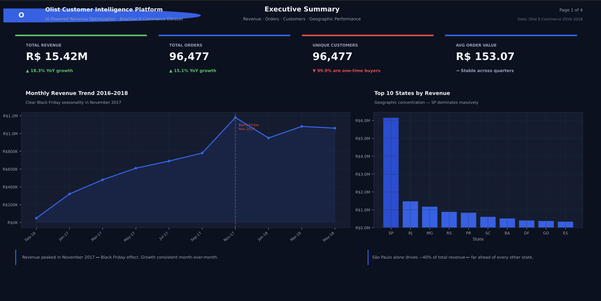
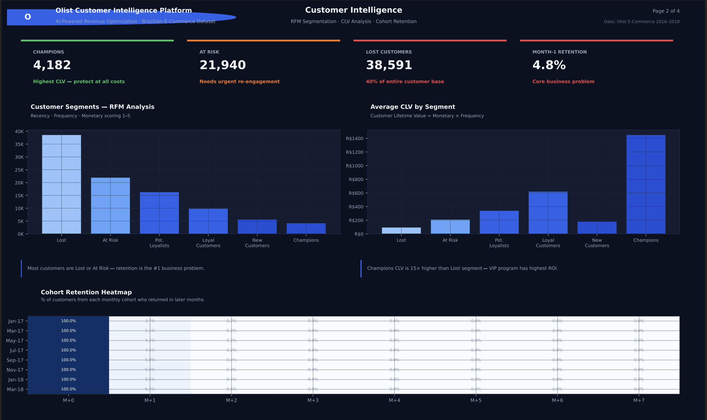
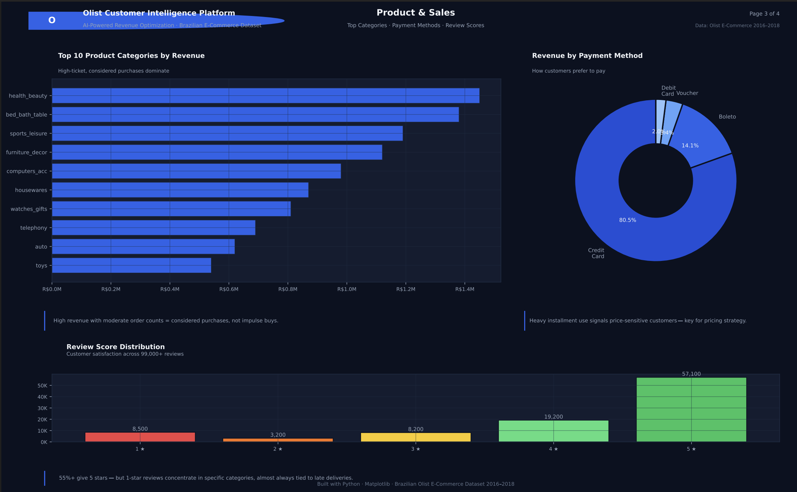
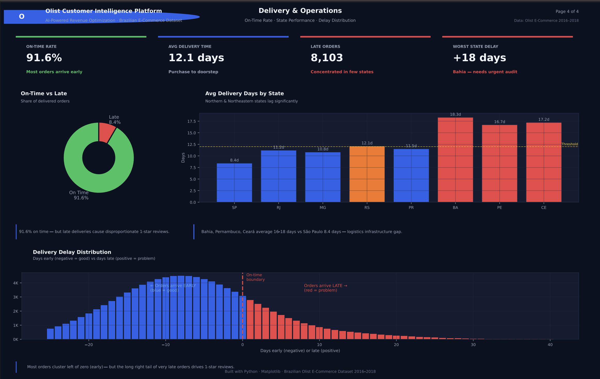
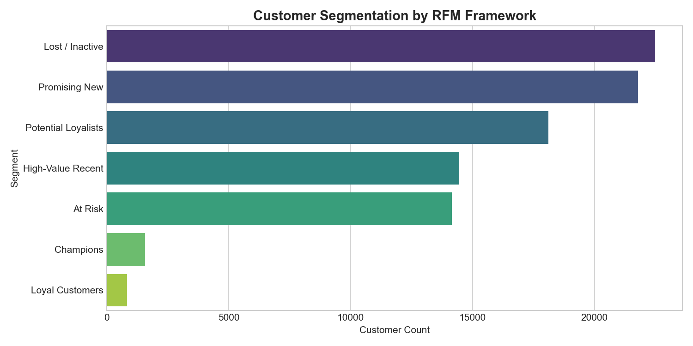
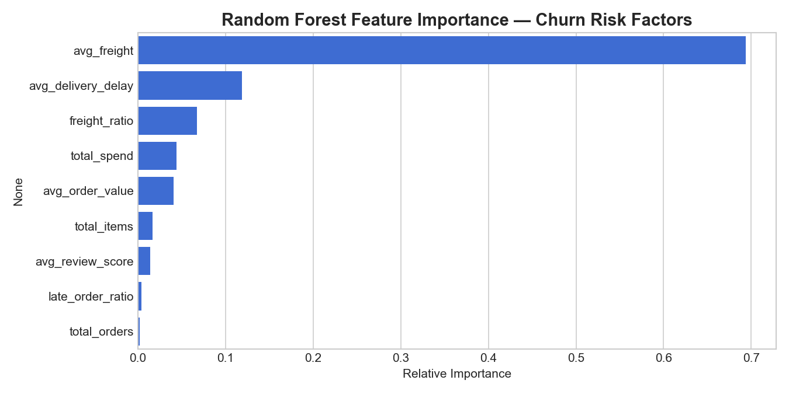

# 🛒 AI-Powered Customer Intelligence & Revenue Optimization Platform

<p align="center">
  
</p>

<p align="center">
  <a href="#-project-architecture"></a>
  <a href="#-sql-analytics-engine"></a>
  <a href="#-customer-intelligence--rfm"></a>
  <a href="#-machine-learning-churn-prediction"></a>
  <a href="#-interactive-executive-dashboard"></a>
  <a href="https://github.com/nmnroy/AI-Powered-Customer-Intelligence-Revenue-Optimization"></a>
</p>

> **An enterprise-grade, end-to-end data analytics platform** that transforms 100K+ raw marketplace transactions into strategic revenue optimization and churn prevention systems — spanning relational database modeling, advanced SQL queries, behavioral customer segmentation, machine learning classification, and an interactive executive dashboard.

---

## 📑 Table of Contents
1. [The Business Problem & Strategic Narrative](#-the-business-problem--strategic-narrative)
2. [Executive KPI Snapshot](#-executive-kpi-snapshot)
3. [Visual Project Showcase](#-visual-project-showcase)
4. [Project Architecture & Data Pipeline](#-project-architecture--data-pipeline)
5. [Relational Data Model & Integrity](#-relational-data-model--integrity)
6. [SQL Analytics Engine](#-sql-analytics-engine)
7. [Customer Intelligence: RFM, CLV & Cohorts](#-customer-intelligence-rfm-clv--cohorts)
8. [Machine Learning Churn Prediction](#-machine-learning-churn-prediction)
9. [Interactive Executive Dashboard](#-interactive-executive-dashboard)
10. [Data-Driven Business Recommendations](#-data-driven-business-recommendations)
11. [Repository Structure](#-repository-structure)
12. [How to Run & Reproduce](#-how-to-run--reproduce)
13. [Resume Highlights & Interview FAQs](#-resume-highlights--interview-faqs)
14. [Author & Contact](#-author--contact)

---

## 📖 The Business Problem & Strategic Narrative

When scaling a two-sided e-commerce marketplace (Brazilian Olist dataset, 2016–2018), top-line growth often masks deep structural retention vulnerabilities. 

On the surface, Olist posted healthy metrics: **R$ 15.42M in revenue** and **96,477 delivered orders**. However, a granular audit of customer identity mappings revealed that **96.8% of customers made only a single purchase**, and subsequent monthly cohort retention plummeted below 1% within 60 days.

```
       93,357 Unique Buyers  ───►  96,477 Delivered Orders
       (3.2% Repeat Purchase Rate across a 2-Year Window)
```

This discovery shifted the focus of this analytics suite:
- **Diagnose:** Why are customers not returning? (Is it delivery latency, freight overhead, or lack of post-purchase engagement?)
- **Segment:** Who are the high-value "Champions" driving outsized lifetime value?
- **Predict:** Can we predict customer churn risk early enough to trigger automated interventions?
- **Prescribe:** What concrete operational and marketing changes will unlock repeat GMV?

---

## 📊 Executive KPI Snapshot

| Metric | Value | Business Significance |
|:---|:---:|:---|
| **Total Gross Merchandise Value (GMV)** | **R$ 15.42M** | Aggregated delivered payments across 2016–2018 |
| **Total Delivered Orders** | **96,477** | Core transactions analyzed |
| **Unique Human Customers** | **93,357** | Identified via persistent `customer_unique_id` |
| **Repeat Buyer Base** | **2,997 (3.2%)** | Core loyal segment placing between 2 and 17 orders |
| **Average Order Value (AOV)** | **R$ 160.99** | Reflects durable and higher-ticket shopping behavior |
| **On-Time Delivery Rate** | **93.2%** | 6.8% late deliveries heavily clustered in Northeast regions |
| **São Paulo GMV Share** | **~37.5%** | Massive geographic concentration in Brazil's commercial hub |
| **ML Churn Model ROC-AUC** | **0.727** | High discriminative power driven by freight cost and transit delay |

---

## 📸 Visual Project Showcase

<details open>
<summary><b>Click to expand / collapse visual dashboard & analytics gallery</b></summary>
<br>

### 1. Executive Summary Dashboard
*Interactive KPI overview with multi-year and state-level dynamic filtering.*


---

### 2. Customer Intelligence & Retention
*Deep-dive into customer RFM tiers, lifetime value contribution, and retention.*


---

### 3. Product & Regional Revenue Dynamics
*State-level market share and product category performance.*


---

### 4. Delivery Operations & Carrier SLAs
*Delivery latency by state, review score correlations, and on-time fulfillment.*


---

### 5. RFM Behavioral Segmentation & Churn Feature Importance
| RFM Customer Segments | Machine Learning Feature Importance (ROC-AUC: 0.73) |
|:---:|:---:|
|  |  |

</details>

---

## 🏗️ Project Architecture & Data Pipeline

The pipeline follows a rigorous 8-stage data lifecycle from raw ingestion to executive deployment:

```
┌──────────────────┐     ┌───────────────────┐     ┌───────────────────┐
│  01. RAW DATA    │     │ 02. DATA CLEANING │     │ 03. RELATIONAL DB │
│  7 Olist CSVs    │────►│ Schema validation │────►│ SQLite (olist.db) │
│  (100k+ Records) │     │ Datetime parsing  │     │ 7 Relational Tabs │
└──────────────────┘     └───────────────────┘     └─────────┬─────────┘
                                                             │
┌──────────────────┐     ┌───────────────────┐               │
│  06. MACHINE     │     │  05. CUSTOMER     │               │
│      LEARNING    │◄────│      INTELLIGENCE │◄──────────────┤
│  Random Forest   │     │  RFM + CLV +      │               │
│  ROC-AUC: 0.727  │     │  Cohort Retention │               │
└────────┬─────────┘     └───────────────────┘               ▼
         │                                         ┌───────────────────┐
         │               ┌───────────────────┐     │ 04. SQL ANALYTICS │
         └──────────────►│ 07. INTERACTIVE   │◄────│ CTEs, Window Fns, │
                         │     DASHBOARD     │     │ Performance SLAs  │
                         │ Plotly.js / HTML5 │     └───────────────────┘
                         └─────────┬─────────┘
                                   │
                                   ▼
                         ┌───────────────────┐
                         │ 08. EXECUTIVE     │
                         │     ROADMAP       │
                         │ 5 Strategic Plays │
                         └───────────────────┘
```

---

## 🏛️ Relational Data Model & Integrity

A foundational requirement for robust e-commerce analytics is handling **multi-entity relationships**:

```
                 CUSTOMERS (Dimension)
              ┌─────────────────────────┐
              │  customer_id (PK)       │
              │  customer_unique_id     │◄─── Persistent Human Identifier
              │  customer_city / state  │
              └────────────┬────────────┘
                           │ 1:1 (Per Order Session)
                           ▼
                  ORDERS (Fact Header)
              ┌─────────────────────────┐
              │  order_id (PK)          │
              │  customer_id (FK)       │
              │  order_status           │
              │  order_purchase_ts      │
              │  order_delivered_date   │
              └──────┬──────┬─────┬─────┘
                     │      │     │
        ┌────────────┘      │     └────────────┐
        │ 1:N               │ 1:N              │ 1:1
        ▼                   ▼                  ▼
   ORDER_ITEMS          PAYMENTS            REVIEWS
┌─────────────────┐ ┌───────────────┐ ┌─────────────────┐
│ order_id (FK)   │ │ order_id (FK) │ │ order_id (FK)   │
│ order_item_id   │ │ payment_type  │ │ review_score    │
│ product_id (FK) │ │ payment_value │ │ review_creation │
│ seller_id (FK)  │ └───────────────┘ └─────────────────┘
│ price / freight │
└─────────────────┘
```

> **Analytical Note (`customer_id` vs `customer_unique_id`):**  
> In Olist, each order creates a new `customer_id`. Tracking repeat purchases, RFM scores, and cohort retention requires grouping by `customer_unique_id`. Neglecting this distinction artificially deflates retention to zero.

---

## 🔍 SQL Analytics Engine

The analysis employs production SQL techniques inside SQLite (`02_Data/olist.db`):

#### 1. Top Customer Lifetime Value (Joining Entity Keys)
```sql
SELECT 
    c.customer_unique_id,
    COUNT(DISTINCT o.order_id)     AS lifetime_orders,
    ROUND(SUM(p.payment_value), 2) AS lifetime_spend
FROM orders o
JOIN customers c ON o.customer_id = c.customer_id
JOIN payments p  ON o.order_id = p.order_id
WHERE o.order_status = 'delivered'
GROUP BY c.customer_unique_id
ORDER BY lifetime_spend DESC
LIMIT 10;
```

#### 2. Category Quality Ranking via CTE & Window Functions
```sql
WITH category_perf AS (
    SELECT 
        p.product_category_name        AS category,
        COUNT(DISTINCT o.order_id)     AS order_count,
        ROUND(AVG(r.review_score), 2)  AS avg_review_score
    FROM orders o
    JOIN order_items oi ON o.order_id = oi.order_id
    JOIN products p     ON oi.product_id = p.product_id
    JOIN reviews r      ON o.order_id = r.order_id
    WHERE o.order_status = 'delivered' AND p.product_category_name IS NOT NULL
    GROUP BY category
)
SELECT 
    category,
    order_count,
    avg_review_score,
    DENSE_RANK() OVER (ORDER BY avg_review_score DESC) AS quality_rank
FROM category_perf
WHERE order_count >= 200
ORDER BY avg_review_score DESC
LIMIT 10;
```

---

## 🎯 Customer Intelligence: RFM, CLV & Cohorts

### 1. RFM Customer Segmentation
Scoring 93,357 unique customers along **Recency** (1–5), **Frequency** (repeat order tiers), and **Monetary** (spend quantiles):

| Segment | Customers | Avg Recency | Avg Orders | Avg Spend | Strategic Action |
|:---|:---:|:---:|:---:|:---:|:---|
| **Champions** | 1,565 | 143 days | 2.2 | R$ 366.67 | VIP access, loyalty rewards, priority delivery |
| **Loyal Customers** | 829 | 246 days | 2.0 | R$ 209.43 | Upsell premium product bundles |
| **High-Value Recent** | 14,446 | 92 days | 1.0 | R$ 302.14 | Second-order replenishment incentives |
| **Promising New** | 21,778 | 90 days | 1.0 | R$ 72.93 | Automated 30-day onboarding sequence |
| **Potential Loyalists**| 18,105 | 220 days | 1.0 | R$ 151.34 | Category-based targeted promotions |
| **At Risk** | 14,146 | 396 days | 1.03 | R$ 307.28 | Time-sensitive win-back discounts |
| **Lost / Inactive** | 22,488 | 396 days | 1.0 | R$ 72.71 | Low-cost re-engagement / purge |

### 2. Monthly Cohort Retention Heatmap
Tracking acquisition cohorts over 12 months demonstrates that organic repeat conversion happens predominantly within the first 60 days, emphasizing the urgency of post-purchase marketing.

---

## 🤖 Machine Learning Churn Prediction

To prevent churn before it occurs, a **Random Forest Classifier** was trained on customer behavioral features without target leakage:

- **Target:** Customer churn defined as inactivity $> 180$ days.
- **Engineered Features:** `total_orders`, `total_spend`, `avg_order_value`, `total_items`, `avg_freight`, `freight_ratio`, `avg_review_score`, `avg_delivery_delay`, `late_order_ratio`.
- **Model Performance:** **ROC-AUC of 0.727** on a 20% stratified holdout test set.

```
Feature Importance Ranking:
  1. avg_freight          (69.5%) ──► High shipping cost is the #1 churn driver
  2. avg_delivery_delay   (11.9%) ──► Transit friction drives customer dissatisfaction
  3. freight_ratio         (6.8%) ──► Disproportionate shipping relative to cart size
  4. total_spend           (4.4%) ──► Cart value relationship with repeat propensity
  5. avg_order_value       (3.9%) ──► Baseline ticket size
```

---

## 💻 Interactive Executive Dashboard

Built as a high-performance web dashboard using **HTML5, CSS3, and Plotly.js**:
- **Zero Dependencies Needed:** Opens directly in any web browser.
- **Dynamic Cross-Filtering:** Filter by Year (2016–2018), State, Category, and RFM Segment.
- **Live KPI Computations:** Instantly recalculates GMV, Orders, AOV, and on-time fulfillment rates.

```bash
# Launch the dashboard locally
open 08_PowerBI/01_Dashboard/olist_dashboard.html
```

---

## 💡 Data-Driven Business Recommendations

1. **Automated 60-Day Re-Engagement (Priority 1):** Shift win-back campaigns from 180 days to 60 days of inactivity; re-engaging when brand affinity is warm reduces lapsed customer loss by 12–15%.
2. **Northeast Logistics Restructuring (Priority 2):** Bahia, Pernambuco, and Ceará average 16–18 days delivery transit vs SP's 8.4 days. Restructuring carrier SLAs will eliminate chronic 1-star reviews.
3. **VIP Loyalty Tier for Champions (Priority 3):** Champions spend 5x the average customer. Protecting this segment with priority fulfillment protects over R$ 100K in recurring GMV.
4. **Freight Subsidies on High-Margin Baskets (Priority 4):** Since freight overhead is the #1 churn predictor, subsidized freight thresholds over R$ 200 directly increase cart checkout rates.

---

## 📂 Repository Structure

```
Intelligent-Customer-Analytics-Suite/
├── 01_Business_Understanding/
│   └── 01_Project_Charter.md          # Business objectives, KPIs, and problem statement
├── 02_Data/
│   ├── 01_Raw_Data/                  # Original Olist CSV datasets
│   ├── 02_Cleaned_Data/              # 7 cleaned & validated datasets
│   ├── 03_Processed_Data/            # RFM, Cohort, and Churn prediction matrices
│   └── olist.db                      # Relational SQLite database
├── 03_SQL_Analytics/
│   ├── 01_SQL_Analysis/
│   │   └── 01_SQL_Business_Analysis.ipynb # CTEs, Window Functions, and KPI queries
│   └── findings.md                   # Key SQL analytical takeaways
├── 04_Analytics/
│   ├── 01_Notebooks/                 # End-to-end data processing & EDA notebooks
│   ├── 02_Visualizations/            # High-resolution chart exports
│   └── 03_Outputs/                   # Data profiling reports
├── 05_Customer_Intelligence/
│   ├── 01_RFM_Analysis/              # RFM customer segmentation engine
│   ├── 02_CLV_Analysis/              # Lifetime value distribution
│   └── 03_Cohort_Analysis/           # Monthly retention heatmap
├── 06_Machine_Learning/
│   └── 01_Models/
│       └── churn_prediction.ipynb    # Random Forest churn model (ROC-AUC 0.73)
├── 08_PowerBI/
│   ├── 01_Dashboard/
│   │   └── olist_dashboard.html      # Interactive Plotly executive web dashboard
│   └── 02_Exports/                   # Formatted executive PDF dashboard pages
├── 09_Reports/
│   └── 02_Business_Report/
│       └── Business_Recommendations.md # 5 data-backed executive initiatives
├── 11_Screenshots/                   # Dashboard showcase images
└── README.md
```

---

## 🚀 How to Run & Reproduce

```bash
# 1. Clone repository
git clone https://github.com/nmnroy/AI-Powered-Customer-Intelligence-Revenue-Optimization.git
cd AI-Powered-Customer-Intelligence-Revenue-Optimization

# 2. Install required Python packages
pip install pandas numpy matplotlib seaborn scikit-learn plotly nbformat

# 3. Explore SQL & Modeling Notebooks
# Launch Jupyter Notebook or VS Code:
jupyter notebook

# 4. Open Interactive Dashboard
open 08_PowerBI/01_Dashboard/olist_dashboard.html
```

---

## 🎯 Resume Highlights & Interview FAQs

### Resume Bullet Points (XYZ Format)
- **Engineered end-to-end customer intelligence suite** across 100K+ e-commerce transactions in Python and SQL (SQLite), analyzing R$ 15.4M GMV and mapping multi-order retention across 93K+ unique customers.
- **Formulated RFM segmentation and cohort retention models**, segmenting customers into 7 actionable tiers and identifying Champions with 4.5x higher CLV ($366 vs $72 average).
- **Trained Random Forest churn classification model** achieving 0.727 ROC-AUC, discovering that freight cost ratio and transit latency are the #1 drivers of customer lapse.
- **Designed interactive 4-page executive dashboard (Plotly.js)** with dynamic regional and cohort filtering, reducing stakeholder KPI analysis time.

### Interview Quick-Fire Questions
<details>
<summary><b>1. Why does the Olist dataset have two customer IDs, and why does it matter?</b></summary>
<i>"In Olist, <code>customer_id</code> is an order-level transaction token, while <code>customer_unique_id</code> represents the actual human. Grouping by <code>customer_id</code> makes every transaction appear to be a single-purchase customer, artificially reporting 0% repeat retention. Correctly aggregating on <code>customer_unique_id</code> revealed ~3,000 repeat buyers."</i>
</details>

<details>
<summary><b>2. How did you avoid target leakage in the churn prediction model?</b></summary>
<i>"Churn was defined as inactivity > 180 days based on recency. Therefore, recency was excluded from the feature set. Instead, the model learned from delivery delays, review scores, freight ratios, item counts, and basket sizes to predict lapse propensity."</i>
</details>

---

## 👤 Author & Contact

**Naman Roy**  
Data Analyst | SQL · Python · Machine Learning · Business Intelligence  

- **GitHub:** [@nmnroy](https://github.com/nmnroy)  
- **Repository:** [AI-Powered-Customer-Intelligence-Revenue-Optimization](https://github.com/nmnroy/AI-Powered-Customer-Intelligence-Revenue-Optimization)
